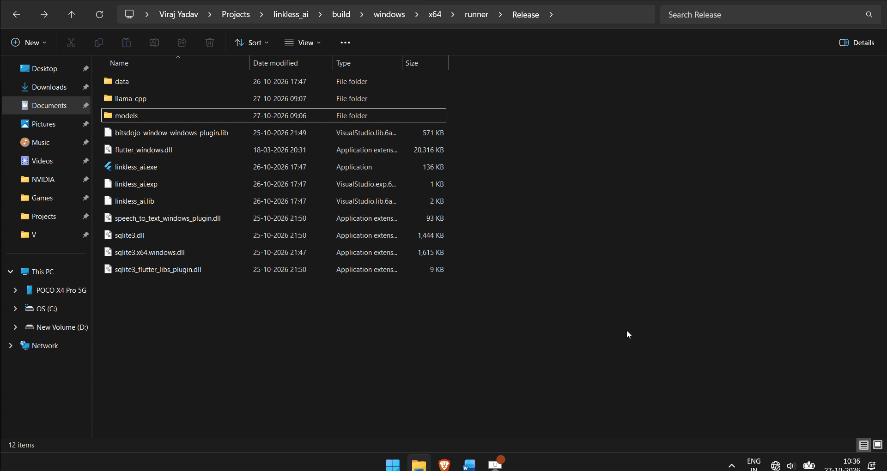
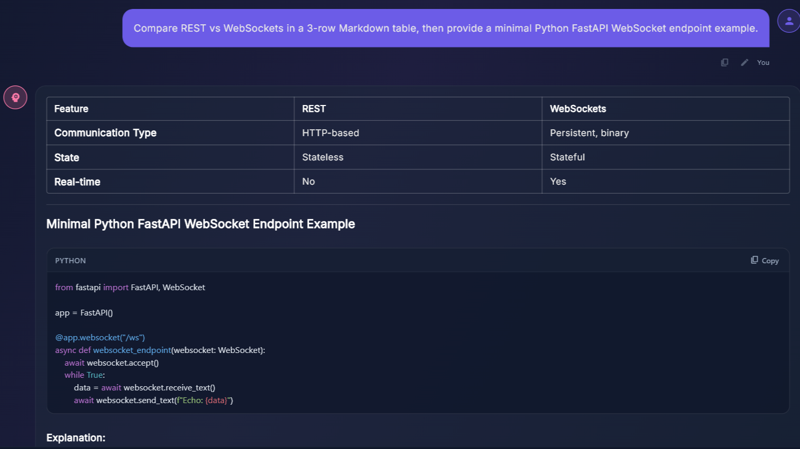
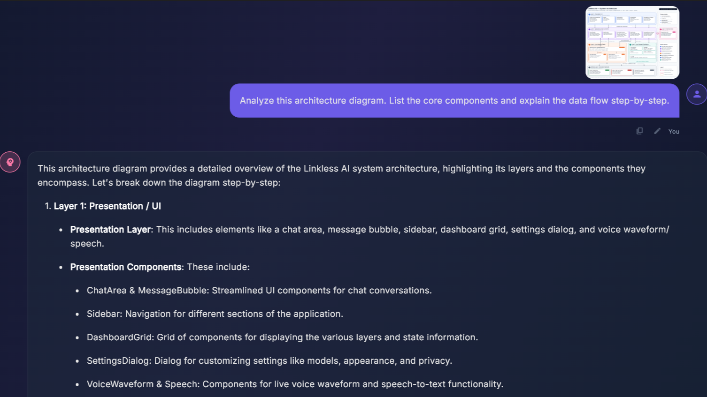
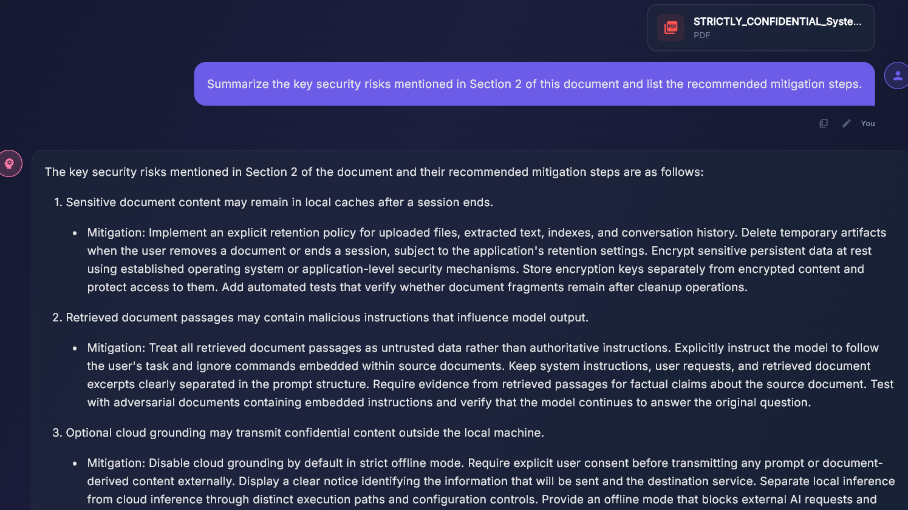
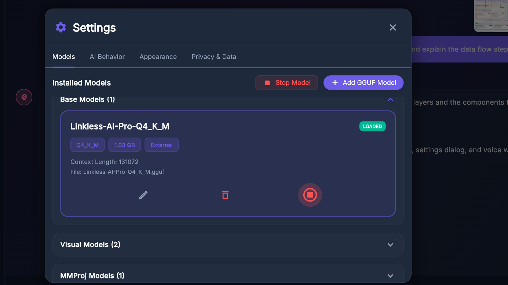
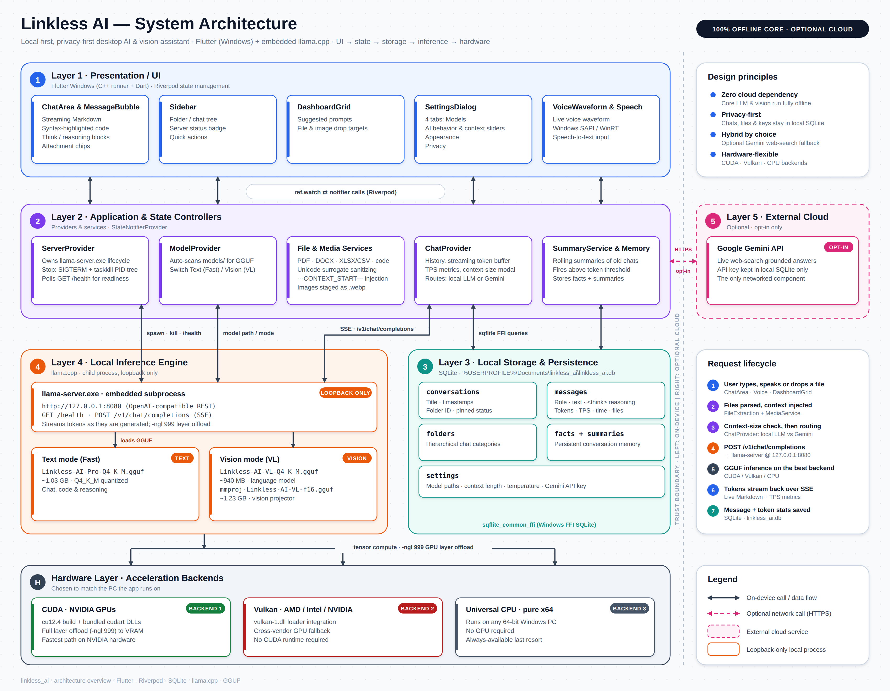

<div align="center">

# 🧠 Linkless AI

**A privacy-first AI assistant for Windows, with local text and vision
models.**

Run AI conversations, analyze images, work with documents, and use voice
input with a local inference engine—without requiring a cloud AI API for
inference.

Built with Flutter, Dart, Riverpod, GGUF models, and
[llama.cpp](https://github.com/ggml-org/llama.cpp).


[Features](#-features) · [Try Linkless AI](#-try-linkless-ai) ·
[Developer setup](#-developer-setup) · [Architecture](#-architecture) ·
[Troubleshooting](#-troubleshooting)

</div>

------------------------------------------------------------------------

## 📽️ Demo

<p align="center">
  
</p>

## 🖼️ Screenshots

|             Chat — Markdown and streaming                 |                  Vision — Image Q&A                       |
|:---------------------------------------------------------:|:---------------------------------------------------------:|
|  |  |

|               Document-assisted chat                      |             Settings and model selection                  |
|:---------------------------------------------------------:|:---------------------------------------------------------:|
|  |  |

-------------------------------------------------------------------------------------------------------------------------

## ✨ Features

| Feature                       | Description                                                                           |
|-------------------------------|---------------------------------------------------------------------------------------|
| **Local text chat**           | Chat with the Linkless AI Pro text model using a local inference server.              |
| **Vision support**            | Submit images to the vision-language model together with its `mmproj` projector file. |
| **Document-assisted chat**    | Extract text from supported document formats and include it in the model's context.   |
| **Voice input**               | Speech input through the app's supported Windows speech integration.                  |
| **Conversation history**      | Store conversation data locally using SQLite.                                         |
| **Model and server controls** | Configure and manage the local `llama-server.exe` process from the app.               |
| **GPU or CPU inference**      | Use a compatible CUDA or Vulkan build when available, with a CPU build as a fallback. |

**Privacy and connectivity:** Once the required runtime assets are
installed, local inference can run without sending prompts to a cloud AI
API. Internet access is still needed to download the app's runtime
assets and updates. Features that depend on external services, if
enabled in a particular build, may require connectivity.

## 🚀 Try Linkless AI (Windows release)

### Requirements

- Windows 10/11, 64-bit.
- Enough free disk space for the application, model downloads, extracted
  engine files, and temporary installation files.
- System memory and hardware appropriate for the selected model. Larger
  models and vision workloads need more resources.
- Internet connection for the initial download of models and the
  inference engine.
- NVIDIA GPU acceleration is optional; the setup script attempts CUDA,
  then Vulkan, then CPU.

### 1. Download the release

Go to the [Linkless AI GitHub Releases
page](https://github.com/frieden300/linkless_ai/releases) and download
the published Windows release package.

> The release includes the compiled Flutter application. The first-time
> runtime setup is handled separately by `setup_release.bat`; Flutter
> and Dart are not required for end users.

### 2. Run first-time setup

1.  Extract the release package to a folder where you want to keep
    Linkless AI.
2.  Run `setup_release.bat` from that folder.
3.  Choose the model configuration that fits your needs.
4.  Wait for the model files and compatible `llama.cpp` engine to
    download.
5.  Launch `linkless_ai.exe`.

`setup_release.bat` creates the `models\` and `llama-cpp\` directories
beside the script and downloads the selected runtime assets.

### Choose your models

| Setup option                  | Downloads                                                        | Approximate model download size | Best for                                             |
|-------------------------------|------------------------------------------------------------------|--------------------------------:|------------------------------------------------------|
| **Text Agent Only**           | Pro text model                                                   |                     **1.03 GB** | Text conversations, reasoning, and coding assistance |
| **Text Agent + Vision Agent** | Pro text model, VL vision-language model, and `mmproj` projector |               **3.20 GB total** | Text tasks plus image understanding                  |

The vision-language model and `mmproj` projector are a pair: the
projector is required by the vision inference setup. Selecting the
text-only option skips both vision files. Sizes are approximate and do
not include the engine download or extra disk space needed during
extraction.

### Model files

| File                                    |  Approximate size | Purpose                                 |
|-----------------------------------------|------------------:|-----------------------------------------|
| `Linkless-AI-Pro-Q4_K_M.gguf`           |           1.03 GB | Text agent                              |
| `Linkless-AI-VL-Q4_K_M.gguf`            |            940 MB | Vision-language model                   |
| `mmproj-Linkless-AI-VL-f16.gguf`        |           1.23 GB | Vision projector used with the VL model |
| `llama-server.exe` and supporting files | Varies by backend | Local inference engine                  |

The setup script skips model files that already exist. If a download is
interrupted, rerun the script and check the error output before using
the affected file.

------------------------------------------------------------------------

## 🧑‍💻 Developer setup

This section is for contributors who want to fork the repository, change
the source code, or compile their own Windows build.

### Prerequisites

| Tool                                                | Required?                      | Notes                                                                      |
|-----------------------------------------------------|--------------------------------|----------------------------------------------------------------------------|
| Git                                                 | Yes                            | To clone the repository and manage changes                                 |
| Flutter SDK                                         | Yes                            | Must be available on `PATH`                                                |
| Dart SDK                                            | Included with Flutter          | Use the version compatible with the repository's `pubspec.yaml`            |
| Visual Studio with **Desktop development with C++** | Yes for Windows desktop builds | Visual Studio Code alone does not provide the required C++ build toolchain |
| Windows 10/11 x64                                   | Yes                            | Target development platform                                                |
| Internet connection                                 | For setup                      | Needed for Flutter packages and optional runtime downloads                 |
| NVIDIA driver / CUDA support                        | Optional                       | Used by the script when a working `nvidia-smi` is detected                 |
| Vulkan-capable driver                               | Optional                       | Used as a fallback when the Vulkan loader is present                       |

Before building, run `flutter doctor -v` and resolve any errors related
to Windows desktop development.

Useful guides:

- [Install
  Flutter](https://docs.flutter.dev/get-started/install/windows/desktop)
- [Set up Windows desktop
  development](https://docs.flutter.dev/platform-integration/windows/setup)
- [Flutter command-line
  tools](https://docs.flutter.dev/reference/flutter-cli)

### 1. Fork and clone the repository

Fork the project on GitHub, then clone your fork. Replace
`YOUR_GITHUB_USERNAME` with your GitHub username.

``` bash
git clone https://github.com/YOUR_GITHUB_USERNAME/linkless_ai.git
cd linkless_ai
```

### 2. Build using `build_project.bat` (recommended)

Run `build_project.bat` from the repository root, or double-click it in
File Explorer.

The script is designed to:

1.  Check that the repository root and required tools are available.
2.  Run `flutter pub get`.
3.  Compile the Windows release with `flutter build windows --release`.
4.  Ask whether to download runtime assets now or skip them to test the
    compilation only.
5.  If runtime setup is selected, let you choose text-only or
    text-plus-vision models.
6.  Detect a suitable inference-engine package using the script's CUDA →
    Vulkan → CPU fallback strategy.
7.  Create directory junctions inside the Flutter Release output so the
    executable can find the root `models\` and `llama-cpp\` folders
    without duplicating the large runtime assets.
8.  Optionally copy a locally available `setup_release.bat` into the
    Release output folder.

**Runtime downloads are optional.** Choose to skip them if you only need
to confirm that the Flutter application compiles. The app may not be
able to perform local inference until its model files and engine are
configured.

### 3. Build manually (alternative)

To fetch dependencies and compile without using the batch script:

``` bash
flutter pub get
flutter build windows --release
```

The expected executable location is:

``` text
build/windows/x64/runner/Release/linkless_ai.exe
```

You can also run the app in debug mode:

``` bash
flutter run -d windows
```

Manual Flutter commands do not download the GGUF models or `llama.cpp`
runtime. Use the batch script or set up the runtime assets yourself if
you want to test local inference.

### 4. Runtime asset directories

The developer script stores large, generated or downloaded runtime
assets at the repository root:

``` text
linkless_ai/
├── models/       # Downloaded GGUF model files; excluded from Git
└── llama-cpp/    # llama.cpp executable and supporting runtime files; excluded from Git
```

For local development, the script creates junctions in the Flutter
Release output:

``` text
build/windows/x64/runner/Release/
├── linkless_ai.exe
├── models/       -> repository-root models/
└── llama-cpp/    -> repository-root llama-cpp/
```

These junctions avoid duplicating several gigabytes of assets on your
development machine. They are local filesystem links, **not portable
copies of the linked files**. Do not distribute a Release folder that
depends on junction targets outside the folder. For end-user
distribution, use the release packaging workflow and
`setup_release.bat`.

### 5. Runtime backend selection

When runtime setup is selected, the developer script attempts to choose
an engine in this order:

1.  **NVIDIA CUDA** — if `nvidia-smi` is available and responds
    successfully, download the CUDA 12.4 `llama.cpp` build and its
    runtime DLL package.
2.  **Vulkan** — if CUDA is not selected or its installation check
    fails, attempt the Vulkan build when the Windows Vulkan loader is
    present.
3.  **CPU** — use the x64 CPU build if the earlier choices fail.

The script runs `llama-server.exe --version` as a basic executable
check. This is not a full GPU or model-inference test. Verify actual
inference on the target hardware before relying on a backend.

### 6. Clean and rebuild

If you need to remove Flutter-generated build output, you can run:

``` bash
flutter clean
flutter pub get
flutter build windows --release
```

`flutter clean` removes Flutter build artifacts, not the repository-root
`models\` and `llama-cpp\` folders. The runtime assets are excluded from
Git and are kept separately from the normal Flutter build output.

------------------------------------------------------------------------

## 🏗️ Architecture
Linkless AI separates the desktop application runtime from the local inference engine, managing hardware-accelerated local LLM processes with zero cloud dependencies.

<p align="center">
  <a href="docs/architecture/detailed_system_architecture.png" target="_blank">
    
  </a>
  <br>
  <em>💡 Tip: Click the image above to view it in full resolution.</em>
</p>

### Codebase overview

| Area                    | Location                | Responsibility                                          |
|-------------------------|-------------------------|---------------------------------------------------------|
| Application entry point | `lib/main.dart`         | Starts the Flutter application                          |
| UI                      | `lib/ui/`               | Screens, widgets, and reusable components               |
| State management        | `lib/providers/`        | Application, chat, model, server, and settings state    |
| AI and prompt logic     | `lib/core/ai/`          | Prompt construction and related AI logic                |
| Data layer              | `lib/data/`             | Models, repositories, and services                      |
| Local inference         | `llama-cpp/` at runtime | Runs the selected `llama.cpp` server binary             |
| Model assets            | `models/` at runtime    | Stores downloaded GGUF weights and the vision projector |

Paths and responsibilities may evolve as the project changes; use the
current source tree as the source of truth when contributing.

## 🤖 Models

Linkless AI distributes its model files through Hugging Face:

- [Linkless AI Pro — text
  model](https://huggingface.co/FriedenNT/LinkLess-AI-Pro)
- [Linkless AI VL — vision-language
  model](https://huggingface.co/FriedenNT/LinkLess-AI-VL)
- [Linkless AI VL — mmproj
  projector](https://huggingface.co/FriedenNT/mmproj-Linkless-AI-VL)

The models are provided in GGUF format for use with a compatible
`llama.cpp` build. The vision setup uses both the VL model and its
corresponding projector file.

## 🛠️ Troubleshooting

### `flutter` is not recognized

Install the Flutter SDK and add its `bin` directory to your system
`PATH`. Open a new terminal and verify:

``` bash
flutter --version
flutter doctor -v
```

### Windows build fails due to missing C++ tools

Install Visual Studio with the **Desktop development with C++**
workload. Visual Studio Code by itself is not enough to compile Flutter
Windows desktop apps.

### Model or engine download fails

Check your internet connection and retry the script. Confirm that the
Hugging Face model URLs and the selected `llama.cpp` release assets are
available. Do not treat a partial download as a valid model.

### The app cannot find the models or engine

- Confirm the `models\` directory contains the selected `.gguf` files.
- Confirm `llama-cpp\llama-server.exe` exists.
- For a developer build, check that the Release directory's `models\`
  and `llama-cpp\` junctions point to the repository-root folders.
- Check the application's Settings and server path configuration if the
  engine is not discovered automatically.

### CUDA or Vulkan does not work

The installer performs a basic executable check, not a complete GPU
inference test. Check the GPU driver, the required runtime DLLs, and the
engine's error output. Try the CPU backend to help distinguish
GPU-specific problems from model or application issues.

### Release folder does not work after copying or zipping

The developer build uses directory junctions to avoid duplicating large
assets. Those links can point outside the copied folder. Use
`setup_release.bat` for the end-user setup flow, or prepare a
self-contained release package with the required runtime files.

------------------------------------------------------------------------

## 🤝 Contributing

Contributions, bug reports, and suggestions are welcome.

1.  Fork the repository.
2.  Create a branch for your change.
3.  Test the change on Windows where possible.
4.  Submit a pull request describing the change and how it was tested.

Please do not commit downloaded GGUF model files, `llama.cpp` binaries,
build output, or private datasets to the repository.

## 📄 License

See the repository's `LICENSE` file for the terms that apply to this
project and its code. Model weights and third-party dependencies may
have separate licenses and terms; review those before redistribution.

------------------------------------------------------------------------

<div align="center">

Built with ❤️ by **Viraj** · [GitHub](https://github.com/frieden300) ·
[Hugging Face](https://huggingface.co/FriedenNT)

*Linkless AI — because your thoughts shouldn't need a Wi-Fi signal.*

</div>
